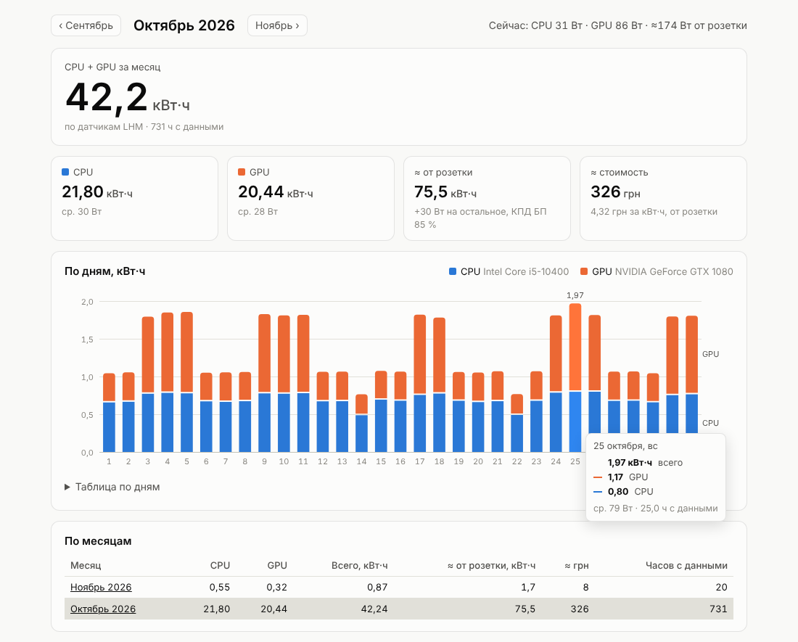

# powermeter

Считает, сколько электроэнергии за день и месяц потребили процессор и видеокарта на Windows-ПК.
Мощность берётся из [LibreHardwareMonitor](https://github.com/LibreHardwareMonitor/LibreHardwareMonitor):
сенсоры «CPU Package» и «GPU Package». Программа переводит её в кВт·ч и показывает
итоги по дням и месяцам на локальной страничке и в консоли.

Один файл на Python 3.8+, только стандартная библиотека — ничего ставить не нужно.



*На скриншоте тестовые данные.*

## Как это работает

- Раз в 2 секунды скрипт запрашивает `data.json` у встроенного веб-сервера LHM.
- Мощность интегрируется по времени (методом трапеций) и копится в SQLite (`powermeter.db` рядом со скриптом) по часам.
- Перерывы длиннее 30 секунд (сон, выключенный ПК, закрытый LHM) не интерполируются и в итог не попадают.
  Колонка «часов с данными» показывает, сколько времени реально записано.
- Работают оба формата LHM: новый, с числовым `RawValue`, и старый, где есть только строка вида `"86,4 W"`.

Откуда LHM берёт значения: «CPU Package» — счётчик энергии RAPL процессора
(Intel/AMD, через драйвер PawnIO), «GPU Package» — мощность всей видеокарты от драйвера
(NVML у NVIDIA, ADL у AMD). Встроенная графика отдельно не считается: она уже входит в CPU Package.

## Установка

1. **LibreHardwareMonitor.** Включи `Options → Remote Web Server → Run` (порт по умолчанию 8085).
   В `Interface / Port` лучше выбрать `127.0.0.1`: через веб-сервер LHM можно ещё и
   управлять вентиляторами, так что выставлять его в сеть незачем.
   Также стоит включить `Options → Run On Windows Startup` и `Start Minimized`.
2. **Проверка связи:**
   ```
   python powermeter.py sensors
   ```
   Должны появиться пометки `← CPU` и `← GPU` возле нужных сенсоров.
   Если сенсор не нашёлся, впиши его `SensorId` в `CHANNELS` в начале скрипта.
3. **Запуск:**
   ```
   python powermeter.py run
   ```
   Страничка: <http://127.0.0.1:8087>

### Запуск службой (NSSM)

```
nssm install PowerMeter "C:\путь\к\python.exe"
nssm set PowerMeter AppParameters "C:\tools\powermeter\powermeter.py run"
nssm set PowerMeter AppDirectory "C:\tools\powermeter"
nssm start PowerMeter
```

Путь к Python покажет `py -c "import sys; print(sys.executable)"`.
Python из Microsoft Store службой не запустится — нужен установщик с python.org.

## Команды

| Команда | Что делает |
|---|---|
| `python powermeter.py sensors` | проверяет связь с LHM и показывает, какие сенсоры выбраны |
| `python powermeter.py run` | запускает логгер и страничку |
| `python powermeter.py report` | отчёт в консоль за текущий месяц и по месяцам |
| `python powermeter.py report 2026-10` | отчёт за указанный месяц |

Общие параметры: `--url` (адрес `data.json` LHM), `--db` (файл базы).
Для `run` также: `--port` (0 — без странички), `--host`, `--poll`.

JSON-API странички: `/api/live` (текущие ватты) и `/api/month?month=ГГГГ-ММ`
(итоги месяца) — например, для Home Assistant или Grafana.

## Настройки

Все настройки — константы в начале `powermeter.py`:

| Параметр | По умолчанию | Смысл |
|---|---|---|
| `LHM_URL` | `http://127.0.0.1:8085/data.json` | веб-сервер LHM |
| `LHM_USER`, `LHM_PASSWORD` | пусто | логин и пароль, если в LHM включена Authentication |
| `CHANNELS` | автопоиск | какие сенсоры считать |
| `OTHER_WATTS` | 30 | Вт на остальное железо: плата, память, диски, вентиляторы |
| `PSU_EFFICIENCY` | 0.85 | КПД блока питания |
| `TARIFF`, `CURRENCY` | 4.32, грн | цена кВт·ч |
| `WEB_HOST`, `WEB_PORT` | 127.0.0.1, 8087 | адрес и порт странички |

## Ограничения

- CPU + GPU — это не всё, что покажет счётчик: остального железа и потерь в блоке
  питания датчики не видят. Поэтому есть отдельная оценка «≈ от розетки»:
  `(CPU + GPU + OTHER_WATTS) / PSU_EFFICIENCY`. Монитор в неё не входит.
  Для точных цифр подгони `OTHER_WATTS` и `PSU_EFFICIENCY` по ваттметру или умной розетке.
- RAPL — это оценка, которую даёт сам процессор, а не прямой замер.
- LHM запускается только после входа в систему. Если после перезагрузки никто не вошёл,
  данных не будет, пока не появится LHM.
- Два логгера на одну базу запустить нельзя: второй экземпляр откажется стартовать,
  иначе всё посчиталось бы дважды.

## Лицензия

MIT
